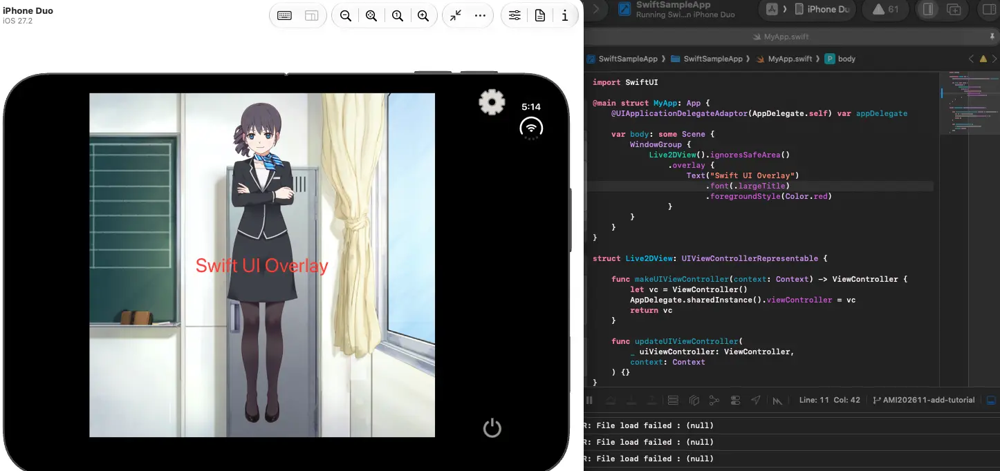

# Tutorial: How to Run the Live2D Cubism Native Sample in SwiftUI

Figure: The app running with a SwiftUI overlay.

## Introduction

> This repository does not include a copy of the Live2D Cubism Native SDK (the Core, the Framework, or the Sample). To follow the tutorial, download the SDK from [the Live2D Cubism official website](https://www.live2d.com/), unzip it, and copy the required source code files and assets into the Xcode project. The repository only keeps a shallow file structure for your reference.
>
> You can find the up-to-date tutorial here: [https://www.amiverse.app/en-us/blog/how-to-use-cubism-sdk-swiftui](https://www.amiverse.app/en-us/blog/how-to-use-cubism-sdk-swiftui)

This repository hosts examples from [our blog tutorial](https://www.amiverse.app/en-us/blog/how-to-use-cubism-sdk-swiftui) about how to build a SwiftUI Xcode project from [Live2D Cubism SDK for Native](https://www.live2d.com/en/sdk/about/). The SDK provides a UIKit-based app sample for iOS devices (the Sample app). The Sample app is built with a [cmake](https://cmake.org/)-generated Xcode project that internally references various source code files and assets in the SDK folder. This design makes it challenging to manage project configurations, such as Xcode build settings, build phases, code files, and assets, with source control. Unless you plan to build an app without touching Xcode at all, you will most likely have to build an Xcode project from scratch.

The tutorial is a hands-on tutorial on how to build a SwiftUI Xcode project from the Sample app. Step by step, we will show how to add [the Cubism Core](https://docs.live2d.com/en/cubism-sdk-manual/cubism-core/) and [the Cubism Framework](https://github.com/Live2D/CubismNativeFramework) to an Xcode project, and how to configure the project to compile all the source code in one build target. Furthermore, we will explain and show how to convert [the Sample app](https://github.com/Live2D/CubismNativeSamples) to a SwiftUI app.

**Learning Objectives**: After this tutorial, you will:

- Build a working Xcode project from the Cubism Sample app
- Understand the composition of the Cubism SDK and the Sample app
- Understand how to compile Objective-C/C++ code in a SwiftUI project
- Understand how to (roughly) convert a UIKit-based app to a SwiftUI app

**Prerequisites**: To successfully complete this tutorial, you'll need:

- [Cubism 5 SDK for Native R5](https://www.live2d.com/en/sdk/about/)
- macOS and Xcode that can build and run an iOS project
- Basic understanding of Swift/SwiftUI apps (syntax and code structure)
- Basic understanding of bash, zsh, or other similar shell scripts
- Willingness to read and modify Objective-C/C++ code

You can find the up-to-date tutorial here: [https://www.amiverse.app/en-us/blog/how-to-use-cubism-sdk-swiftui](https://www.amiverse.app/en-us/blog/how-to-use-cubism-sdk-swiftui)
