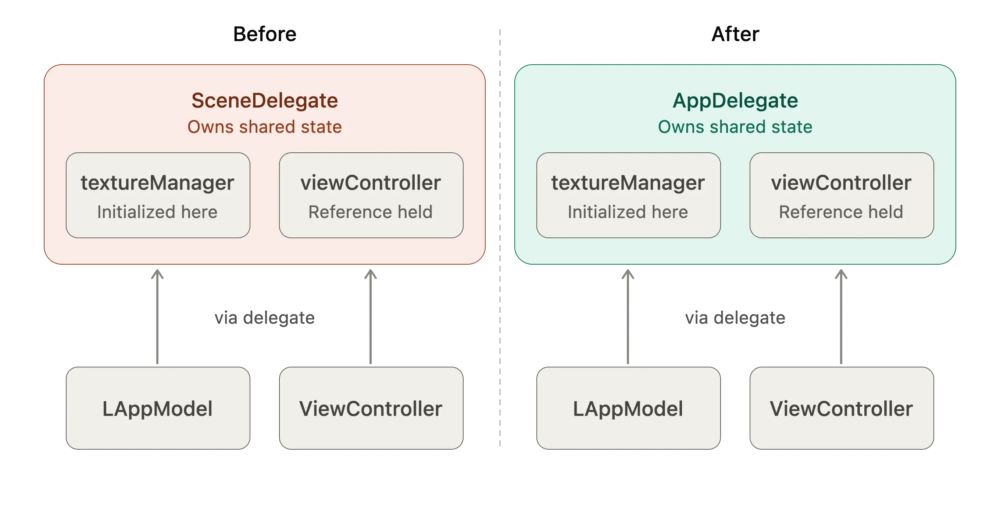
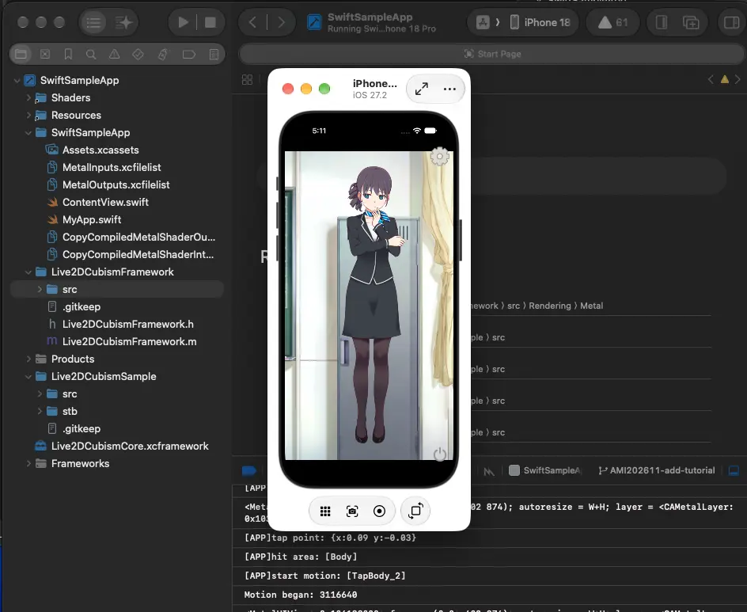

# Tutorial: How to Run Live2D Cubism Native Sample in SwiftUI


Figure: The app run with a SwiftUI overlay.

## Introduction

This post talks about how to build a SwiftUI Xcode project from [Live2D Cubism SDK for Native](https://www.live2d.com/en/sdk/about/). The SDK provides a UIKit-based app sample for iOS devices (the Sample app). However, probably to meet the cross-platform requirement, the Sample app is built with a [cmake](https://cmake.org/)-generated Xcode project that internally references various source code and assets in the SDK folder. This design makes it challenging to manage project configurations, such as Xcode build settings, build phases, code files and assets, with source control. Unless you plan to build an app without messing with Xcode at all, most likely you'd have to build an Xcode project from scratch.

In addition, the Sample app is built with UIKit and a mix of Objective-C/C++ and C++ code, which probably feels "legacy" to most iOS developers nowadays who prefer (or start with) Swift and SwiftUI on the developer journey. Swift/SwiftUI not only has simpler syntax to help build faster but also makes long-term project management easier (so you never need to worry about finding a new UIKit person or adopting new features from SwiftUI).

This post is a hands-on tutorial about how to build a SwiftUI Xcode project from the Sample app. Step by step, we will show how to add [the Cubism Core](https://docs.live2d.com/en/cubism-sdk-manual/cubism-core/) and [the Cubism Framework](https://github.com/Live2D/CubismNativeFramework) to an Xcode project; we will show how to configure the project to compile all the source code in one build target. Furthermore, we will explain and show how to convert [the Sample App](https://github.com/Live2D/CubismNativeSamples) to a SwiftUI app.

**Learning Objectives**: After this post, you will:

- Build a working Xcode project from the Cubism Sample app
- Understand the composition of the Cubism SDK and the Sample app
- Understand how to compile Objective-C/C++ code in a SwiftUI project
- Understand how to (roughly) convert a UIKit-based app to a SwiftUI app

**Prerequisites**: To successfully go through this post, you'll need:

- [Cubism 5 SDK for Native R5](https://www.live2d.com/en/sdk/about/)
- macOS and Xcode that can build and run an iOS project
- Basic understanding of Swift/SwiftUI apps (syntax and code structure)
- Basic understanding of bash, zsh or other similar shell scripts
- Willingness to read and modify Objective-C/C++ code

## Overview

- Download the Cubism Native SDK (Core, Framework, Sample)
  - Download the SDK from the official website
  - Build an XCFramework from the Core SDK
- Build and configure an Xcode project
  - Copy source files from the Framework and the Sample app
  - Configure the project to build the framework and the app
- Compile everything in Xcode
  - Compile Metal shader code (.metal) to libraries (.metallib)
  - Compile the Framework
  - Clean up and compile the Sample app code
- Build a SwiftUI app from the UIKit Sample app
  - Migrate to SwiftUI: Remove SceneDelegate and New States
  - Wire up the AppDelegate and ViewController to SwiftUI
  - Add missing resources to the app bundle
  - Build and test on a simulator and a physical device

## Step 1: Download the Cubism Native SDK (Core, Framework, Sample)

### Download the SDK from the Official Website

Go to [the Live2D official website](https://www.live2d.com/en/sdk/about/) and download the Cubism SDK for Native. Read through the Software License Agreement and, if you consent to the License, download the Cubism 5 SDK for Native R5. You will get a zip file like `CubismSdkForNative-5-r.5.zip`.

Unzip the archive, and you should see three folders: Core, Framework, and Samples. These are the three pillars of Live2D Cubism applications ([see Cubism Core API Reference](https://docs.live2d.com/en/cubism-sdk-manual/cubism-core-api-reference/)) and have everything we need to build our SwiftUI app.

```txt
CubismSdkForNative-5-r.5
├── Core
│   ├── dll
│   ├── include     // we need this
│   └── lib
├── Framework
│   └── src         // we need this
└── Samples
    ├── Common
    ├── D3D11
    ├── D3D9
    ├── Metal       // we need this
    ├── OpenGL
    ├── Resources   // we need this
    └── Vulkan
```

In this post, we do not need to build the Sample app with cmake. We will grab the source code files directly and build our Xcode project from scratch. To learn more about this SDK, you can read another post on our blog here (TBA).

### Build an XCFramework from the Core SDK

First, we need to obtain a copy of the Cubism Core library built for iOS platforms. The Core comes with necessary APIs to process Live2D model files from the Cubism Editor. Open `Core/lib/ios` and you should see the following:

```txt
CubismSdkForNative-5-r.5/Core/lib/ios
├── Debug-iphoneos
├── Debug-iphonesimulator-arm64
├── Debug-iphonesimulator-x86_64
├── Release-iphoneos
│   └── libLive2DCubismCore.a         // *
├── Release-iphonesimulator-arm64
│   └── libLive2DCubismCore.a         // *
└── Release-iphonesimulator-x86_64
```

The R5 SDK comes with static libraries (`.a`) for physical devices (`iphoneos`) and simulators (`iphonesimulator`). Here we will use the release builds of `iphoneos` and the arm64 version of `iphonesimulator`. To help add the Core to an Xcode project, we can build an XCFramework from the static libraries:

```sh
CORE_DIR="CubismSdkForNative-5-r.5/Core"

xcodebuild -create-xcframework \
  -library "$CORE_DIR/lib/ios/Release-iphoneos/libLive2DCubismCore.a" \
  -headers "$CORE_DIR/include" \
  -library "$CORE_DIR/lib/ios/Release-iphonesimulator-arm64/libLive2DCubismCore.a" \
  -headers "$CORE_DIR/include" \
  -output Live2DCubismCore.xcframework
```

After that, you should see a `Live2DCubismCore.xcframework` folder there (as follows). We will need it when compiling the Cubism Framework.

```sh
Live2DCubismCore.xcframework
├── Info.plist
├── ios-arm64
│   ├── Headers
│   │   └── Live2DCubismCore.h
│   └── libLive2DCubismCore.a
└── ios-arm64-simulator
    ├── Headers
    │   └── Live2DCubismCore.h
    └── libLive2DCubismCore.a
```

## Step 2: Build And Configure An Xcode Project

Next, we need an Xcode project to build and run a SwiftUI app. Just open Xcode and create a new SwiftUI project. We call it `SwiftSampleApp`:

```txt
SwiftSampleApp
├── SwiftSampleApp
│   ├── Assets.xcassets
│   ├── ContentView.swift
│   └── MyApp.swift
└── SwiftSampleApp.xcodeproj
    ├── project.xcworkspace
    ├── xcuserdata
    └── project.xcproj
```

### Copy source files from the Framework and the Sample app

We need to copy the source files from the Framework and the Sample app to the Xcode project. First, create a static framework target in the project settings:

- Open the Xcode project settings (the top-level item in the left Navigators).
- In the TARGETS panel, click on the bottom left "+" to add a static library.
- Set the product name `Live2DCubismFramework`.
- Set the language `Objective-C`.
- Click Finish to create the target.

You should see a new folder `Live2DCubismFramework` in the navigators. Next, we need to copy the source code from the Framework in the SDK:

- In the SDK folder, find `Framework/src`
- Drag the whole `src` folder into the `Live2DCubismFramework` folder in the Xcode navigators
- Xcode will ask you to choose options for adding the files:
  - Set Action to "Copy files to destination"
  - In Targets, check the static library target `Live2DCubismFramework` we just created.
  - Once you click Finish, you will see the source code files in the navigators.
- Also, drag the `Live2DCubismCore.xcframework` we created above to the Xcode project.
  - Action: "Copy files to the destination"
  - Targets: only check the `Live2DCubismFramework` target.
- (Optional) delete all CMakeLists.txt from the subfolders.
- (Optional) except for `src/Rendering/Metal`, delete all platform folders in the `src/Rendering` folder.

Next, copy the Sample app code to the project:

- Create a new `Live2DCubismSample` folder in the Xcode navigators.
- In the SDK folder, find `Samples/Metal`. Drag the following to the `Live2DCubismSample`:
  - `Samples/Metal/Demo/proj.ios.cmake/src`
  - `Samples/Metal/thirdParty/stb`
- Xcode will ask you to choose options for adding the files:
  - Action: "Copy files to destination".
  - Targets: only check the target `SwiftSampleApp`.
- In the `src` folder, delete `Info.plist` and `main.m`.
- (Optional) delete all CMakeLists.txt from the subfolders.
  At this point, we have all the files we need to build the SwiftUI app. But the project is not ready to compile and would throw all kinds of error messages. To get it to work, we need to set and flip some project settings.

### Configure the project to build the framework and the app

> When you are working on this part, make sure you select the right target on the left panel of the project settings. Each target has its own settings.
>
> If you do not see any build setting item above, try to switch to "All" on the second row of the Build Settings tab. If you see names in constant style, e.g., "SWIFT_OBJC_BRIDGING_HEADER", switch to "Title" from "Names" on the second row. For more details about build settings, check out the [build settings reference](https://developer.apple.com/documentation/xcode/build-settings-reference).

We need to configure the project to build the framework and the app separately. This is probably frustrating because the Xcode UI may be a little complicated to play with. The following is a step-by-step list to configure the project. Note that this configuration is not complete yet, and we will come back to it when we see compilation errors later.

**For the framework target:**

Let's start with the framework target. The Framework C++ code needs to know where to find required headers. Because part of the code uses quoted includes and the rest uses angled ones, we need to set both the system and user header search paths.

- Go to the Xcode project settings and select `Live2DCubismFramework`:
- Under Build Settings:
  - "System Header Search Paths" = `Live2DCubismFramework/src`, non-recursive.
  - "User Header Search Paths" = `Live2DCubismFramework/src`, recursive.

**For the app target:**

There are 3 things to set here: header search path, Swift/C++ interop, and bridge header. Like the framework, some Sample app code needs to know about the Framework header. Also, because we are compiling the ObjC/C++ Sample code in our Swift project, we need to enable interop and add a bridge header.

- Create a file "cubism_bridge_header.h" in `Live2DCubismSample/src`
- Go to the Xcode project settings and select the app target.
- Under Build Settings:
  - "System Header Search Paths" = `Live2DCubismFramework/src`, non-recursive.
  - "User Header Search Paths" = `Live2DCubismSample/stb`, non-recursive
  - "C++ and Objective-C Interoperability" = "C++ / Objective-C++"
  - "Bridging Header" = `Live2DCubismSample/src/cubism_bridge_header.h`

## Step 3: Compile Everything In Xcode

At this point, your Xcode project can compile to some extent. But you will start seeing error messages such as Metal compilation errors or undefined symbols. To successfully compile the app, we need to update the build process accordingly. Specifically, we will update Build Phases (and some source code) to compile Metal shaders, the Framework, and the Sample/app.

### Compile Metal shader code (.metal) to libraries (.metallib)

In this version of Cubism SDK for Native, we start seeing many Metal shader files (.metal) that are compiled into libraries (.metallib) before building the Framework. By default, Xcode automatically compiles them together into one default library. This process unfortunately does not fit the Framework's workflow, which needs each Metal shader to be in its own library. Instead of refactoring the Framework shader loader, we try to replicate the existing workflow in Xcode by script.

First, we need to disable the default Metal compilation process in Xcode:

- Go to the Build Phases of the `Live2DCubismFramework` target.
- Under Compile Sources, remove all .metal files. You can press the command key and select multiple files first, and then press the delete key to remove them together.

> Be careful, do not remove any other source files. If you remove one by accident, you can add it later when the compiler complains the file is missing. Or, consider using git or a version control tool to track your xcode project file.

Once .metal files are removed from the list, Xcode will no longer compile the shader files for you. Now we can add a script step to compile each shader file into a library:

- Go to the Build Phases of the `Live2DCubismFramework` target.
- Click on the plus sign ("+") in the top left and add a new Run Script phase.
- (Optional) Rename the phase to "Compile Metal Shaders" or something readable.
- (Optional) Drag the phase before the Compile Sources phase.
- Copy and paste the `compile_metal_shaders.sh` script below to the run script phase.

Due to [the user script sandboxing setting](https://developer.apple.com/documentation/xcode/build-settings-reference#User-Script-Sandboxing), we have to declare the input and output files:

- Add two files to `SwiftSampleApp`: MetalInputs.xcfilelist and MetalOutputs.xcfilelist
- Copy and paste the content of `SwiftSampleApp/MetalInputs.xcfilelist` and `SwiftSampleApp/MetalOutputs.xcfilelist` below into the files.
- In the same run script phase:
  - Add `$(SRCROOT)/SwiftSampleApp/MetalInputs.xcfilelist` to Input File Lists.
  - Add `$(SRCROOT)/SwiftSampleApp/MetalOutputs.xcfilelist` to Output File Lists.

`compile_metal_shaders.sh`:

```sh
# Compile each Metal shader file to a library of the same name. It will output multiple .metallib files (and intermediate .air artifacts) to the Xcode product folder. Later, we will use another script to move the .metallib files into the app bundle.

set -e

SRC_DIR="$SRCROOT/Live2DCubismFramework/src/Rendering/Metal/Shaders"
AIR_DIR="$DERIVED_FILE_DIR/FrameworkShaders/MetalAir"
OUT_DIR="$TARGET_BUILD_DIR/$UNLOCALIZED_RESOURCES_FOLDER_PATH/FrameworkShaders/FrameworkMetallibs"

mkdir -p "$AIR_DIR" "$OUT_DIR"

for f in "$SRC_DIR"/*.metal; do
  name=$(basename "$f" .metal)
  srcFile="$f"
  airFile="$AIR_DIR/$name.air"
  outFile="$OUT_DIR/$name.metallib"

  echo "Compiling: $name"
  xcrun -sdk "$PLATFORM_NAME" metal -D CSM_ALPHA_BLEND_MODE=1 -D CSM_COLOR_BLEND_MODE=1 -c "$srcFile" -o "$airFile"
  xcrun -sdk "$PLATFORM_NAME" metallib "$airFile" -o "$outFile"

  echo "Done: $outFile"
done
```

`SwiftSampleApp/MetalInputs.xcfilelist`:

```txt MetalInputs.xcfilelist
$(SRCROOT)/Live2DCubismFramework/src/Rendering/Metal/Shaders/BlendShaderFuncs.h
$(SRCROOT)/Live2DCubismFramework/src/Rendering/Metal/Shaders/BlendShaderStructs.h
$(SRCROOT)/Live2DCubismFramework/src/Rendering/Metal/Shaders/MetalShaderTypes.h
$(SRCROOT)/Live2DCubismFramework/src/Rendering/Metal/Shaders/FragShaderSrcAlphaBlend.metal
$(SRCROOT)/Live2DCubismFramework/src/Rendering/Metal/Shaders/FragShaderSrcBlend.metal
$(SRCROOT)/Live2DCubismFramework/src/Rendering/Metal/Shaders/FragShaderSrcColorBlend.metal
$(SRCROOT)/Live2DCubismFramework/src/Rendering/Metal/Shaders/FragShaderSrcMaskBlend.metal
$(SRCROOT)/Live2DCubismFramework/src/Rendering/Metal/Shaders/FragShaderSrcMaskInvertedBlend.metal
$(SRCROOT)/Live2DCubismFramework/src/Rendering/Metal/Shaders/FragShaderSrcMaskInvertedPremultipliedAlphaBlend.metal
$(SRCROOT)/Live2DCubismFramework/src/Rendering/Metal/Shaders/FragShaderSrcMaskPremultipliedAlphaBlend.metal
$(SRCROOT)/Live2DCubismFramework/src/Rendering/Metal/Shaders/FragShaderSrcPremultipliedAlphaBlend.metal
$(SRCROOT)/Live2DCubismFramework/src/Rendering/Metal/Shaders/MetalShaders.metal
$(SRCROOT)/Live2DCubismFramework/src/Rendering/Metal/Shaders/VertShaderSrcBlend.metal
$(SRCROOT)/Live2DCubismFramework/src/Rendering/Metal/Shaders/VertShaderSrcMaskedBlend.metal
```

`SwiftSampleApp/MetalOutputs.xcfilelist`:

```txt MetalOutputs.xcfilelist
$(DERIVED_FILE_DIR)/FrameworkShaders/MetalAir/FragShaderSrcAlphaBlend.air
$(DERIVED_FILE_DIR)/FrameworkShaders/MetalAir/FragShaderSrcBlend.air
$(DERIVED_FILE_DIR)/FrameworkShaders/MetalAir/FragShaderSrcColorBlend.air
$(DERIVED_FILE_DIR)/FrameworkShaders/MetalAir/FragShaderSrcMaskBlend.air
$(DERIVED_FILE_DIR)/FrameworkShaders/MetalAir/FragShaderSrcMaskInvertedBlend.air
$(DERIVED_FILE_DIR)/FrameworkShaders/MetalAir/FragShaderSrcMaskInvertedPremultipliedAlphaBlend.air
$(DERIVED_FILE_DIR)/FrameworkShaders/MetalAir/FragShaderSrcMaskPremultipliedAlphaBlend.air
$(DERIVED_FILE_DIR)/FrameworkShaders/MetalAir/FragShaderSrcPremultipliedAlphaBlend.air
$(DERIVED_FILE_DIR)/FrameworkShaders/MetalAir/MetalShaders.air
$(DERIVED_FILE_DIR)/FrameworkShaders/MetalAir/VertShaderSrcBlend.air
$(DERIVED_FILE_DIR)/FrameworkShaders/MetalAir/VertShaderSrcMaskedBlend.air

$(TARGET_BUILD_DIR)/$(UNLOCALIZED_RESOURCES_FOLDER_PATH)/FrameworkShaders/FrameworkMetallibs/FragShaderSrcAlphaBlend.metallib
$(TARGET_BUILD_DIR)/$(UNLOCALIZED_RESOURCES_FOLDER_PATH)/FrameworkShaders/FrameworkMetallibs/FragShaderSrcBlend.metallib
$(TARGET_BUILD_DIR)/$(UNLOCALIZED_RESOURCES_FOLDER_PATH)/FrameworkShaders/FrameworkMetallibs/FragShaderSrcColorBlend.metallib
$(TARGET_BUILD_DIR)/$(UNLOCALIZED_RESOURCES_FOLDER_PATH)/FrameworkShaders/FrameworkMetallibs/FragShaderSrcMaskBlend.metallib
$(TARGET_BUILD_DIR)/$(UNLOCALIZED_RESOURCES_FOLDER_PATH)/FrameworkShaders/FrameworkMetallibs/FragShaderSrcMaskInvertedBlend.metallib
$(TARGET_BUILD_DIR)/$(UNLOCALIZED_RESOURCES_FOLDER_PATH)/FrameworkShaders/FrameworkMetallibs/FragShaderSrcMaskInvertedPremultipliedAlphaBlend.metallib
$(TARGET_BUILD_DIR)/$(UNLOCALIZED_RESOURCES_FOLDER_PATH)/FrameworkShaders/FrameworkMetallibs/FragShaderSrcMaskPremultipliedAlphaBlend.metallib
$(TARGET_BUILD_DIR)/$(UNLOCALIZED_RESOURCES_FOLDER_PATH)/FrameworkShaders/FrameworkMetallibs/FragShaderSrcPremultipliedAlphaBlend.metallib
$(TARGET_BUILD_DIR)/$(UNLOCALIZED_RESOURCES_FOLDER_PATH)/FrameworkShaders/FrameworkMetallibs/MetalShaders.metallib
$(TARGET_BUILD_DIR)/$(UNLOCALIZED_RESOURCES_FOLDER_PATH)/FrameworkShaders/FrameworkMetallibs/VertShaderSrcBlend.metallib
$(TARGET_BUILD_DIR)/$(UNLOCALIZED_RESOURCES_FOLDER_PATH)/FrameworkShaders/FrameworkMetallibs/VertShaderSrcMaskedBlend.metallib
```

> Alternatively, you can disable the script sandboxing setting, but this may raise some security concerns.

Once you have the run script phase ready, rebuilding the framework target will give you multiple .metallib files in the build product folder, even though Xcode still fails to compile the rest of the source code. To find the product folder, on the Xcode menu go to "Product" > "Show Build Folder in Finder". You should see something like:

```txt
.../Debug-iphonesimulator/
├── FrameworkShaders
│   └── FrameworkMetallibs
│       ├── FragShaderSrcAlphaBlend.metallib
│       ├── FragShaderSrcBlend.metallib
│       ├── FragShaderSrcColorBlend.metallib
│       ├── FragShaderSrcMaskBlend.metallib
│       ├── FragShaderSrcMaskInvertedBlend.metallib
│       ├── FragShaderSrcMaskInvertedPremultipliedAlphaBlend.metallib
│       ├── FragShaderSrcMaskPremultipliedAlphaBlend.metallib
│       ├── FragShaderSrcPremultipliedAlphaBlend.metallib
│       ├── MetalShaders.metallib
│       ├── VertShaderSrcBlend.metallib
│       └── VertShaderSrcMaskedBlend.metallib
└── ...
```

We will add these files to our app bundle later. Now, let's get Xcode to compile the Framework code.

### Compile the Framework

We just copied multiple source files from the Framework to our static library `Live2DCubismFramework`. If you try to build it, you should see a bunch of error messages about "ARC" or the "release" and "autorelease" keywords. ARC stands for _Automatic Reference Counting_, a memory management system used by Swift and Objective-C in Xcode. In our project here, you only need to know that ARC does not like you manually calling keywords like `release` to manage memory by hand.

> You can learn more about ARC from [this WWDC video](https://developer.apple.com/videos/play/wwdc2021/10216/) or [the wiki page](https://en.wikipedia.org/wiki/Automatic_Reference_Counting).

Instead of refactoring the Framework code that manually manages memory, we resort to adding the "no ARC" flag to some source code files. To do this:

- Go to Build Phases of the `Live2DCubismFramework` target.
- Under Compile Sources, add `-fno-objc-arc` to the Compiler Flags of files that raise ARC errors.

If you have time, you can compile and fix each file one by one. Here are the files we set in our project:

- CubismShader_Metal.mm
- CubismRenderTarget_Metal.mm
- CubismCommandBuffer_Metal.mm

After setting the flag, our `Live2DCubismFramework` should compile successfully!

> ...and, there are a LOT of issues and warnings. They are mostly about some parameters not found in the declaration. If you have time, or really want to use it in production, we'd suggest that you go over the code and address them accordingly, including the ARC issue.

### Clean up and compile the Sample app code

The next challenging task is compiling the Sample app code in Xcode. This is very similar to the Framework compilation task above except we need to link additional libraries and patch part of the code. If you try to build the app target, you will see these kinds of errors flying around.

Let's fix them step by step. First, we need to add the `Live2DCubismFramework` we just built to the app target:

- Go to the Build Phases of the `SwiftSampleApp` app target.
- Under "Link Binary With Libraries":
  - Add `libLive2DCubismFramework.a` from our project.
  - Also add `MetalKit.framework` from Apple SDKs.

Next, we also need to disable ARC for some Sample code files. Under Compile Sources, add `-fno-objc-arc` to the Compiler Flags of files in the following list:

- AppDelegate.mm
- LAppLive2DManager.mm
- LAppSprite.mm
- LAppModelSprite.mm
- LAppTextureManager.mm
- ViewController.mm
- MetalView.m

Meanwhile, in the same Compile Sources list, delete `SceneDelegate.mm`. We do not need this file in our SwiftUI app because SwiftUI has its own scene management process. We will cover this later when we start building the app.

The Xcode project should start complaining that some methods should not return a value. It's because some void functions in the Sample code `return nil;`, which is not allowed in our Xcode compilation process. We need to go to the file and replace it with `return;`. Here is a list to go through:

- LAppSprite.mm
  - Remove the "return self" statement from "resizeImmidiate".
  - Replace "return nil;" with "return;" in SetMTLFunction.
  - Replace "return nil;" with "return;" in SetMTLRenderPipelineState.

## Step 4: Build A SwiftUI App From The UIKit Sample App

At this point, the compiler starts complaining about undefined symbols in the app code. that's a good sign! To make the Sample code work in SwiftUI, we need to remove some UIKit/legacy code to migrate to SwiftUI.

### Migrate to SwiftUI: Remove SceneDelegate and New States

> You can find the patched files in [SwiftSampleApp/Live2DCubismSample/src](SwiftSampleApp/Live2DCubismSample/src).
>
> For your reference, we also keep a copy of the changes we made in [changes.patch](changes.patch). It may help you find where and how to patch the source code. Because the file may be incomplete, the best source of truth is still your compiler and its error messages. Keep trying and addressing issues iteratively.
>
> Also, Xcode does not report compiler errors in some Objective-C/C++ code, only issues and warnings. Check the Xcode Issue Navigator for any glaring issues in those files.


Figure: The Pattern Before and After the Migration.

The original sample code is based on UIKit and comes with SceneDelegate. This is the UIKit way to manage the life-cycle events in a scene ([see UISceneDelegate](https://developer.apple.com/documentation/uikit/uiscenedelegate)). SwiftUI has a new life-cycle system to manage the scene, so we no longer need the scene delegate in our project. To remove it from our project:

1. Remove SceneDelegate.mm and SceneDelegate.h from `Live2DCubismSample/src`.
1. Remove scene-related imports and processes from the source code.
1. Move states managed by the scene delegate to somewhere else.

The first step should be easy; however, the other two steps may be ambiguous. Here comes the most difficult part of this tutorial: we need to replace the scene delegate and transfer its responsibility to somewhere else, such as AppDelegate. If you get lost, you can just download a complete copy of those files from our repository. See [SwiftSampleApp/Live2DCubismSample/src](SwiftSampleApp/Live2DCubismSample/src) for more details.

Here is what we did during the migration:

1. Remove scene-related processes from AppDelegate.
1. Keep a reference of ViewController and an LAppTextureManager in AppDelegate.
1. Keep a singleton property of AppDelegate for other code to access the view controller and the texture manager.
1. Remove all "SceneDelegate.h" imports from the rest of the code base.
1. Replace all access to the view controller and the texture manager with the AppDelegate version.

After this, Xcode should compile and run the app successfully, but there is nothing on the screen.

### Wire up the AppDelegate and ViewController to SwiftUI

Now, we need to wire up the app delegate and the view controller to our SwiftUI view. We can do this with `@UIApplicationDelegateAdaptor` and call those Objective-C/C++ types in Swift through the bridge header.

First, update our MyApp.swift:

```swift MyApp.swift
import SwiftUI

@main struct MyApp: App {
    @UIApplicationDelegateAdaptor(AppDelegate.self) var appDelegate

    var body: some Scene {
        WindowGroup {
            Live2DView().ignoresSafeArea()
        }
    }
}

struct Live2DView: UIViewControllerRepresentable {

    func makeUIViewController(context: Context) -> ViewController {
        let vc = ViewController()
        AppDelegate.sharedInstance().viewController = vc
        return vc
    }

    func updateUIViewController(
        _ uiViewController: ViewController,
        context: Context
    ) {}
}
```

Xcode will throw out many errors around the ViewController and AppDelegate. We need to import their headers in the `cubism_bridge_header.h` bridge header file we created earlier. Add the following imports to the file:

```h
#import "AppDelegate.h"
#import "ViewController.h"
```

Now, all the above errors should be gone. If you run the app again, you will see the following messages in the console:

```txt
[CSM][I]Live2D Cubism Core version: 06.00.0001 (100663297)
[CSM][I]CubismFramework::StartUp() is complete.
[CSM][I]CubismFramework::Initialize() is complete.
```

This means our SwiftUI app successfully found the AppDelegate and initialized the Cubism SDK! However, the app crashed right after that due to `EXC_BAD_ACCESS`. That was because we had not added assets and resources into the app bundle, such as Live2D models, background images, and shader libraries.

### Add missing resources to the app bundle

There are several things we need to include in the app bundle, such as Live2D model files, background images, shader libraries, etc.

**Assets such as Live2D models and background images:**

The Cubism SDK ships with a set of example Live2D models in `Samples/Resources`. We need to move them to our app bundle.

- Go to the build phases of the app target
- Add a new copy files phase. Rename it to "Copy Live2D Resources"
  - Destination: "Resources"
  - Subpath: "Res" (which matches the settings in `LAppDefine.mm`).
- Use "+ > Add Other..." to copy the whole `Samples/Resources` folder

**The SpriteEffect shader from the Cubism Sample Code:**

- Go to the build phases of the app target.
- Add a new copy bundle resources phase if it's not already there.
- Use "+ > Add Other..." to copy the whole `SwiftSampleApp/Live2DCubismSample/src/Shaders` folder to the bundle resources.

**Compiled metal shaders (.metallib):**

- Go to the build phases of the app target.
- Add a new script run phase. Rename it to "Copy Compiled Metal Shaders"
- Add the following script to the script box.
- Add the following xcfilelists to the input and output file lists.
  - Input File Lists: `$(SRCROOT)/SwiftSampleApp/CopyCompiledMetalShaderInputs.xcfilelist`
  - Output File Lists: `$(SRCROOT)/SwiftSampleApp/CopyCompiledMetalShaderOutputs.xcfilelist`

`copy_compiled_metal_shaders.sh`:

```sh
set -e

SRC="${BUILT_PRODUCTS_DIR}/FrameworkShaders/FrameworkMetallibs"
DST="${TARGET_BUILD_DIR}/${UNLOCALIZED_RESOURCES_FOLDER_PATH}/FrameworkMetallibs"
if [ ! -d "$SRC" ]; then
  echo "Failed: Framework metallibs not found at $SRC"
  exit 1
fi

mkdir -p "$DST"

found=0
for lib in "$SRC"/*.metallib; do
  [ -e "$lib" ] || continue
  cp -f "$lib" "$DST/"
  echo "Copied $(basename "$lib") to $DST"
  found=1
done

if [ "$found" -eq 0 ]; then
  echo "Failed: No .metallib files found in $SRC"
  exit 1
fi
```

`CopyCompiledMetalShaderInputs.xcfilelist`:

```txt
$(BUILT_PRODUCTS_DIR)/FrameworkShaders/FrameworkMetallibs/FragShaderSrcAlphaBlend.metallib
$(BUILT_PRODUCTS_DIR)/FrameworkShaders/FrameworkMetallibs/FragShaderSrcBlend.metallib
$(BUILT_PRODUCTS_DIR)/FrameworkShaders/FrameworkMetallibs/FragShaderSrcColorBlend.metallib
$(BUILT_PRODUCTS_DIR)/FrameworkShaders/FrameworkMetallibs/FragShaderSrcMaskBlend.metallib
$(BUILT_PRODUCTS_DIR)/FrameworkShaders/FrameworkMetallibs/FragShaderSrcMaskInvertedBlend.metallib
$(BUILT_PRODUCTS_DIR)/FrameworkShaders/FrameworkMetallibs/FragShaderSrcMaskInvertedPremultipliedAlphaBlend.metallib
$(BUILT_PRODUCTS_DIR)/FrameworkShaders/FrameworkMetallibs/FragShaderSrcMaskPremultipliedAlphaBlend.metallib
$(BUILT_PRODUCTS_DIR)/FrameworkShaders/FrameworkMetallibs/FragShaderSrcPremultipliedAlphaBlend.metallib
$(BUILT_PRODUCTS_DIR)/FrameworkShaders/FrameworkMetallibs/MetalShaders.metallib
$(BUILT_PRODUCTS_DIR)/FrameworkShaders/FrameworkMetallibs/VertShaderSrcBlend.metallib
$(BUILT_PRODUCTS_DIR)/FrameworkShaders/FrameworkMetallibs/VertShaderSrcMaskedBlend.metallib
```

`CopyCompiledMetalShaderOutputs.xcfilelist`:

```txt
$(TARGET_BUILD_DIR)/$(UNLOCALIZED_RESOURCES_FOLDER_PATH)/FrameworkMetallibs/FragShaderSrcAlphaBlend.metallib
$(TARGET_BUILD_DIR)/$(UNLOCALIZED_RESOURCES_FOLDER_PATH)/FrameworkMetallibs/FragShaderSrcBlend.metallib
$(TARGET_BUILD_DIR)/$(UNLOCALIZED_RESOURCES_FOLDER_PATH)/FrameworkMetallibs/FragShaderSrcColorBlend.metallib
$(TARGET_BUILD_DIR)/$(UNLOCALIZED_RESOURCES_FOLDER_PATH)/FrameworkMetallibs/FragShaderSrcMaskBlend.metallib
$(TARGET_BUILD_DIR)/$(UNLOCALIZED_RESOURCES_FOLDER_PATH)/FrameworkMetallibs/FragShaderSrcMaskInvertedBlend.metallib
$(TARGET_BUILD_DIR)/$(UNLOCALIZED_RESOURCES_FOLDER_PATH)/FrameworkMetallibs/FragShaderSrcMaskInvertedPremultipliedAlphaBlend.metallib
$(TARGET_BUILD_DIR)/$(UNLOCALIZED_RESOURCES_FOLDER_PATH)/FrameworkMetallibs/FragShaderSrcMaskPremultipliedAlphaBlend.metallib
$(TARGET_BUILD_DIR)/$(UNLOCALIZED_RESOURCES_FOLDER_PATH)/FrameworkMetallibs/FragShaderSrcPremultipliedAlphaBlend.metallib
$(TARGET_BUILD_DIR)/$(UNLOCALIZED_RESOURCES_FOLDER_PATH)/FrameworkMetallibs/MetalShaders.metallib
$(TARGET_BUILD_DIR)/$(UNLOCALIZED_RESOURCES_FOLDER_PATH)/FrameworkMetallibs/VertShaderSrcBlend.metallib
$(TARGET_BUILD_DIR)/$(UNLOCALIZED_RESOURCES_FOLDER_PATH)/FrameworkMetallibs/VertShaderSrcMaskedBlend.metallib

```

### Build and test on a simulator and a physical device

Congrats! You should be able to build and run the app successfully in a simulator or a physical device! All the functionality should be the same (drag to track, tap to play a motion, tap the gear to change to the next model, etc.), except some issues with certain Live2D models (see Limitations below). From this project, you can start building new features with Swift/SwiftUI. You can also try to rewrite the view controller and app delegate for better state management, especially when you want to build other features in your app.


Figure: The app run in an iPhone simulator.

## Conclusion

In this post, we walked through how to turn the Cubism Native Sample app into a SwiftUI Xcode project. We built an XCFramework from the Cubism Core, added the Cubism Framework as a static library target, and configured the project to compile Objective-C/C++ code next to Swift. To make the code work in SwiftUI, we removed the UIKit SceneDelegate and transferred its functions accordingly to the AppDelegate. Finally, we wrote a simple SwiftUI wrapper to run the app with the same Cubism Native workflow.

Keep in mind that this app is still a UIKit sample wearing a SwiftUI coat. Much of the legacy logic is intact, a few warnings remain, and some Live2D models may not render correctly. For a production app, you'll probably want to go further: clean up the ARC issues, trim the Objective-C/C++ code down to a thin wrapper, and expose a Swift-friendly interface for controlling the Live2D model.

We hope this tutorial gives you a solid starting point.

## Limitations

The SwiftUI sample app is based on the original Sample app. The overall logic should be almost the same as the original one, including control, view, state, resource, and asset management. Because the logic is not optimized for SwiftUI, the app may have performance issues or produce inconsistent results in SwiftUI views. We also found some Live2D models did not work in the SwiftUI app due to unknown shader issues.

If you plan to build an app for production, it is suggested that you review the original Sample code, refactor or clean up legacy features, and rebuild [the Cubism initialization process](https://docs.live2d.com/en/cubism-sdk-manual/cubismnativeframework/) to better integrate the logic into [the modern SwiftUI life cycle](https://developer.apple.com/documentation/swiftui/migrating-to-the-swiftui-life-cycle). For example, you can minimize Objective-C/C++ code by having a light wrapper around the Sample view controller, keeping only the abilities you need, cleaning up deprecated types and features, and creating/exposing public interfaces for Swift views to call internal processes to control the Live2D model.

## References

- [Live2D. n.d. Cubism SDK for Native.](https://www.live2d.com/en/sdk/about/)
- [Live2D. n.d. Cubism Core.](https://docs.live2d.com/en/cubism-sdk-manual/cubism-core/)
- [Live2D. n.d. Cubism Core API Reference.](https://docs.live2d.com/en/cubism-sdk-manual/cubism-core-api-reference/)
- [Live2D. n.d. Cubism Native Framework (documentation).](https://docs.live2d.com/en/cubism-sdk-manual/cubismnativeframework/)
- [Live2D. n.d. CubismNativeFramework (GitHub).](https://github.com/Live2D/CubismNativeFramework)
- [Live2D. n.d. CubismNativeSamples (GitHub).](https://github.com/Live2D/CubismNativeSamples)
- [Kitware. n.d. CMake.](https://cmake.org/)
- [Apple. n.d. Build settings reference (including User Script Sandboxing).](https://developer.apple.com/documentation/xcode/build-settings-reference)
- [Apple. n.d. UISceneDelegate.](https://developer.apple.com/documentation/uikit/uiscenedelegate)
- [Apple. n.d. Migrating to the SwiftUI life cycle.](https://developer.apple.com/documentation/swiftui/migrating-to-the-swiftui-life-cycle)
- [Apple. 2021. ARC in Swift: Basics and beyond (WWDC21).](https://developer.apple.com/videos/play/wwdc2021/10216/)
- [Apple. 2023. Mix Swift and C++.](https://developer.apple.com/videos/play/wwdc2023/10172/)
- [Wikipedia. n.d. Automatic Reference Counting.](https://en.wikipedia.org/wiki/Automatic_Reference_Counting)
